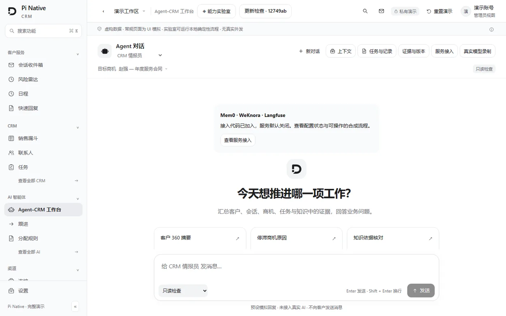
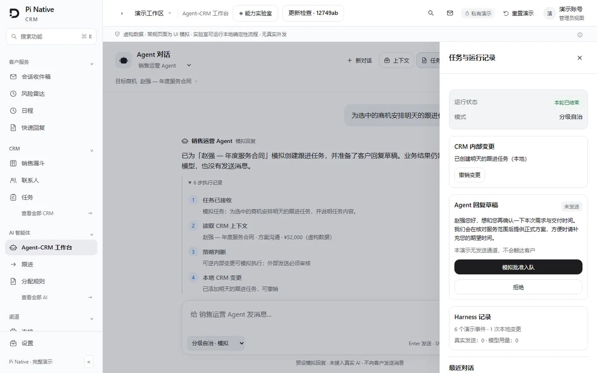
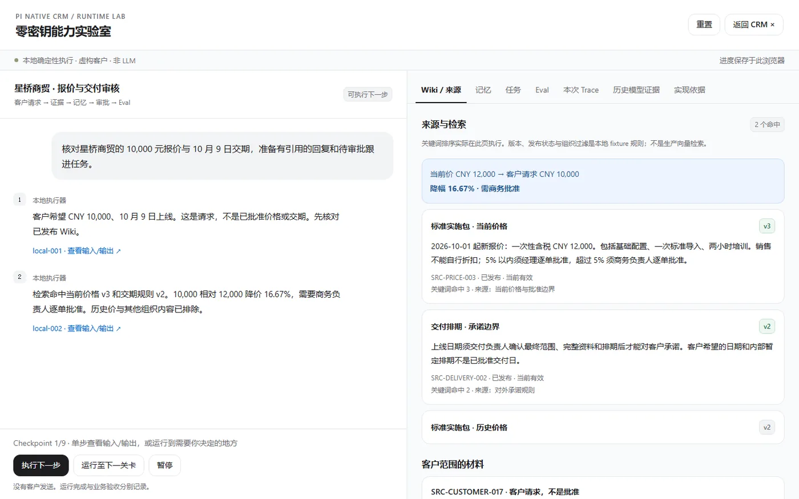
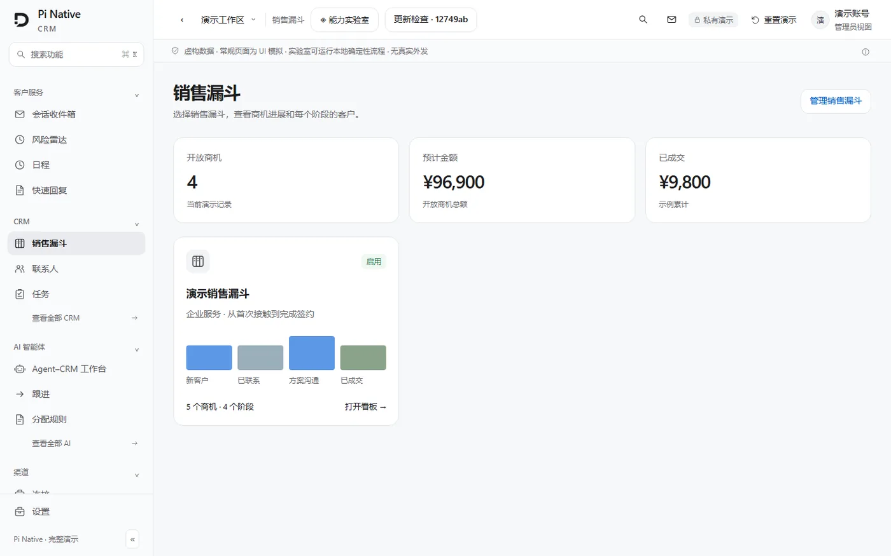
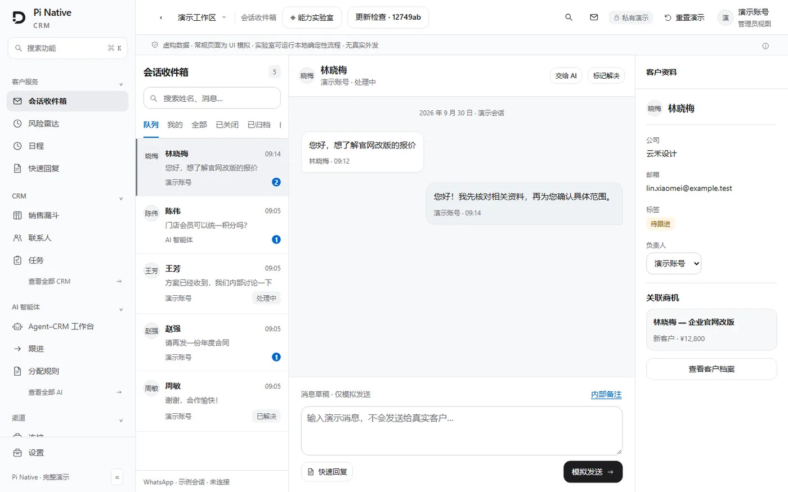
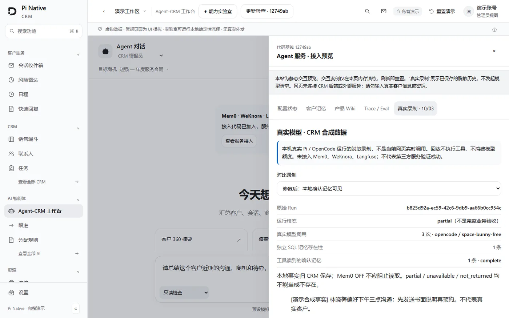
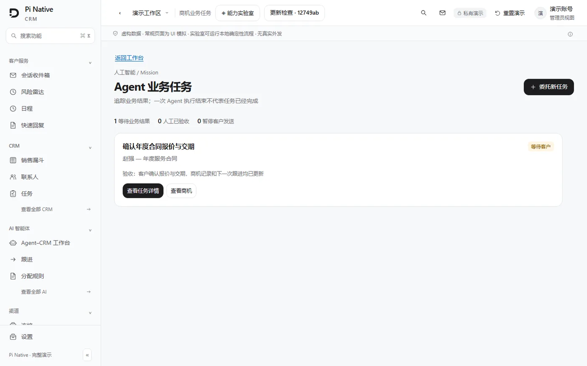
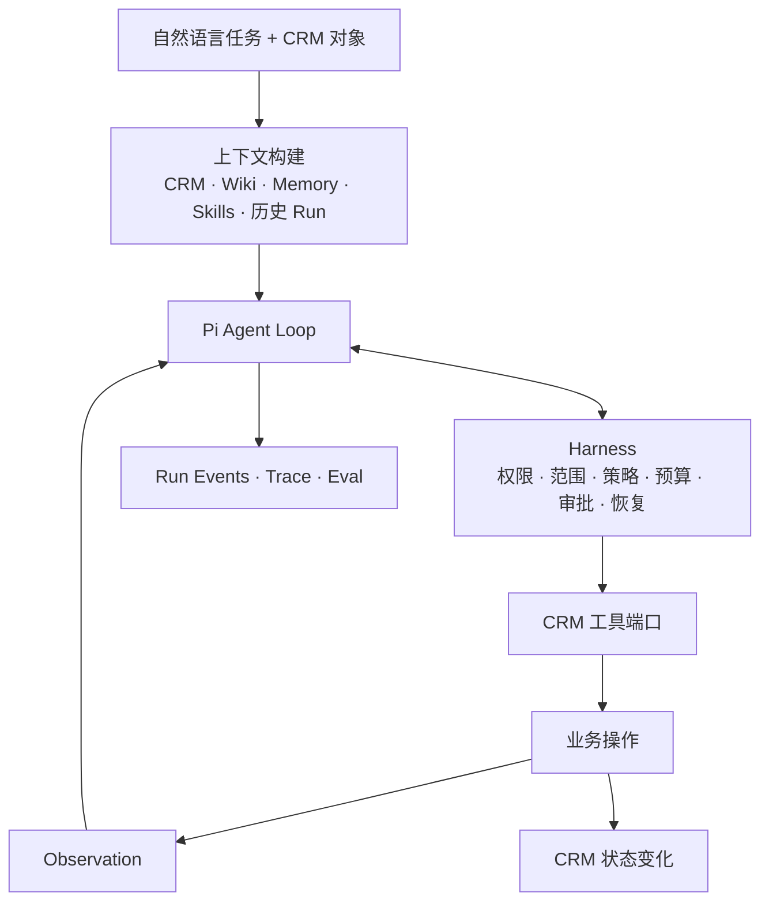

<div align="center">

# Pi Native CRM

**以真实 CRM 为状态空间的 Agent 原生工作台**

让 Agent 读取客户与商机，消费知识和记忆，调用工具推进业务；<br />
让人看清它做了什么、依据什么，以及 CRM 发生了哪些变化。

[](https://nextjs.org)
[](https://react.dev)
[](https://www.typescriptlang.org)
[](https://tailwindcss.com)
[](https://supabase.com)
[](https://nodejs.org)
[](https://pnpm.io)
[](LICENSE)

[**在线演示**](https://xxstar-01.github.io/ai-native-crm-demo/#/app/ai/workbench) ·
[架构说明](docs/architecture/README.md) ·
[开发配置](docs/SETUP.md) ·
[文档索引](docs/index.md) ·
[当前状态](docs/current-state.md)

</div>



> **CRM 保存业务事实，Pi 驱动 Agent 行动，Harness 管理执行边界。**

---

## 目录

- [这是什么](#这是什么)
- [界面预览](#界面预览)
- [核心能力](#核心能力)
- [设计取舍](#设计取舍)
- [工作原理](#工作原理)
- [技术栈](#技术栈)
- [快速开始](#快速开始)
- [目录结构](#目录结构)
- [质量与验证](#质量与验证)
- [文档](#文档)
- [许可](#许可)

---

## 这是什么

Pi Native CRM 是一个内部研发的 **Agent-native CRM 工作台**。联系人、会话、商机、跟进任务和知识库构成 Agent 的工作环境；自然语言目标成为执行入口。

我们关注的不只是生成一段回复，而是完整的业务动作：理解上下文、寻找证据、拆解任务、协同调查、调用工具、观察结果，再决定下一步。CRM 的价值在于提供真实对象、业务约束和可核验的状态变化。

打开工作台，选择一个内置 Agent 和目标对象，就能开始任务。执行过程、工具调用、审批、数据变化与评测都围绕同一个 **Run** 展开。

> 当前为内部研发版本，主分支围绕 Agent 工作台、受控 CRM 工具、多 Agent 协作、商机 Mission、知识记忆和 Eval 持续迭代。

---

## 界面预览

<table>
  <tr>
    <td width="50%"></td>
    <td width="50%"></td>
  </tr>
  <tr>
    <td align="center"><sub>执行记录 · CRM 内部变更 · 待审草稿 · Harness 记录</sub></td>
    <td align="center"><sub>能力实验室：请求 → 证据 → 记忆 → 审批 → Eval</sub></td>
  </tr>
  <tr>
    <td width="50%"></td>
    <td width="50%"></td>
  </tr>
  <tr>
    <td align="center"><sub>销售漏斗：阶段、金额与停滞风险</sub></td>
    <td align="center"><sub>会话收件箱：AI 与人工协同处理</sub></td>
  </tr>
</table>

<table>
  <tr>
    <td width="50%"></td>
    <td width="50%"></td>
  </tr>
  <tr>
    <td align="center"><sub>真实模型录制回放：脱敏事件、用量与 Eval</sub></td>
    <td align="center"><sub>商机 Mission：跨运行保存目标与业务验收</sub></td>
  </tr>
</table>

> 截图来自仓库自带的静态演示（虚构数据、无后端），入口见[快速开始](#快速开始)。

---

## 核心能力

### Agent 工作台

- 以任务和 CRM 对象为入口，支持**只读调查**与**行动模式**。
- 在同一条时间线上查看上下文、决策、工具调用、Observation 和状态变化。
- 查看模型绑定、Token 用量、工具次数、预算与终止原因。
- 通过持久化事件和 SSE 续读，在刷新后回放执行过程。

### 四个内置 Agent

| Agent | 职责 |
| --- | --- |
| **CRM 情报员** | 汇总客户、历史会话、商机、知识与记忆，形成带证据的客户画像 |
| **销售运营 Agent** | 排查停滞商机、更新字段、调整阶段、安排后续跟进 |
| **客户沟通 Agent** | 结合会话和知识起草回复，核对承诺依据，提出转人工动作 |
| **CRM 主管 Agent** | 跨漏斗、任务和执行记录调查异常，组织专职 Agent 协作并汇总结果 |

组织预装内置 Agent，并提供可直接选择的场景任务。内置原件保持锁定，通过「复制并定制」创建自己的 Agent；原件跟随组织默认模型，副本固定创建时的模型配置。

### 受控执行 Harness

- Agent 的 CRM 读写经过**工具端口**，权限、组织作用域和目标范围贯穿执行。
- 按**读取、可逆写入、外部动作、不可逆动作**分类管理工具。
- 自动执行读取与具备业务补偿能力的写入，对外动作通过人工确认。
- 保存字段差异、审计记录和撤销动作，将批准后的工具结果带回后续执行。
- 支持暂停、恢复、取消、执行租约、重试和累计预算控制。

### 多 Agent 与商机 Mission

- 主管 Agent 组织只读专职 Agent 调查，使用父子 Run 保存各自的上下文与结果。
- 独立调查支持并行执行，父 Run 统一管理业务写入和预算。
- 商机 Mission 保存目标、验收条件、截止时间和跨运行进度。
- 将客户回复、内部协作回复和负责人补充方向接入任务续跑。
- 通过结构化结果、证据核验与方向版本，关联任务判断和 CRM 动作。

### 知识与记忆

- 本地 RAG 与 WeKnora Wiki 检索接口，为回答提供知识来源、页面版本与引用。
- 联系人事实经人工确认后进入 CRM 记忆，供后续会话和任务消费。
- Mem0 接入检索排序、记忆同步、删除与清理回执。
- 组织记忆、客户记忆、知识材料和运行历史分层管理，SQL 保持业务事实源。
- 组织 Skill、版本和参考资料加载接口，为 Agent 提供领域能力。

### Eval 与可观测性

- 围绕任务结果、证据、工具可靠性、策略遵守和记忆覆盖进行评测。
- 结合确定性检查、真实模型语义评审与回归样例，保存评分依据。
- Langfuse 接收模型与工具边界的 Trace、用量和 Eval 分数。
- 通过持久化投递队列、去重与重试关联 CRM Run 和外部观测记录。
- 在工作台回看真实模型录制、工具调用及评测结果，复用脱敏验证样例。

---

## 设计取舍

- **工具分四类，只自动放行前两类**：读取和可补偿写入直接执行；外部动作与不可逆动作必须人工确认，审批结果回灌到后续执行，而不是一次性的弹窗。
- **状态变化必须有证据**：字段差异、审计记录、撤销动作与 Run 事件同源，回答"它为什么这么做"。
- **业务事实与执行状态分家**：CRM 数据库保存业务事实，Run、事件与检查点保存执行状态，刷新后可续读。
- **凭据与预算在组织层**：模型凭据与服务凭据由服务端保管，不写入运行事件或提交记录；预算按 Run 累计。
- **Agent 不是唯一入口**：人可以从任务、商机、会话任意位置进入，也可以随时接管。

---

## 工作原理



CRM 产品层通过自有接口调用运行内核；Pi 类型封装在适配层中。CRM 数据库保存业务事实，Run、事件与检查点保存执行状态。知识和记忆提供依据，工具负责动作，评测负责反馈。

### 灵活集成

| 能力 | 接入 |
| --- | --- |
| **模型** | 组织级真实凭据、默认模型绑定、固定模型版本；OpenAI、Anthropic、Google 及兼容接口 |
| **Memory** | Mem0 客户记忆适配器，与 CRM 确认事实、同步队列和生命周期管理衔接 |
| **LLM Wiki** | WeKnora 知识检索与来源接口，与本地 RAG、组织知识权限衔接 |
| **Trace / Eval** | Langfuse 项目绑定、OTLP Trace 和评测分数投递 |
| **WhatsApp** | WAHA 会话与消息工具，将客户沟通纳入审批和审计 |
| **飞书** | 企业身份映射、成员绑定、消息队列、回复关联与任务续跑接口 |

第三方服务按组织绑定和启用，接入配置由服务端管理。

---

## 技术栈

| 层 | 选型 |
| --- | --- |
| **前端** | Next.js 16（App Router）· React 19 · TypeScript 6 · Tailwind 4 · shadcn/ui |
| **后端** | Route Handlers · Server Actions · 独立 worker 与 scheduler |
| **数据** | Supabase Postgres（RLS）· Storage · Realtime |
| **队列** | `event_log` + worker drain + cron |
| **Agent** | Pi Agent Core / Pi AI（Vercel AI SDK 仅用于辅助调用） |
| **知识 / 记忆** | 本地 RAG · WeKnora · Mem0 |
| **观测** | Langfuse · Sentry · 自建 Eval |
| **测试** | Vitest · Playwright · 数据库不变量测试 |

---

## 快速开始

### 1. 在线演示（零依赖）

已部署的静态演示，纯前端、虚构数据，不连接后端：

**<https://xxstar-01.github.io/ai-native-crm-demo/#/app/ai/workbench>**

本地运行同一个演示：

```bash
node scripts/serve-agent-demo.mjs
# http://127.0.0.1:3008/#/app/ai/workbench
```

包含合成 CRM 场景与脱敏的真实模型录制回放；「能力实验室」可本地执行确定性的审批、重试与 Eval 流程。

### 2. 完整开发环境

准备 **Node.js 22+**、**pnpm**，以及 Supabase 与 Redis 配置。

```bash
pnpm install --frozen-lockfile

# 仅在配置文件不存在时创建，保留已有配置
test -e .env.local || cp .env.example .env.local
test -e .env || touch .env
```

> 以上命令为 bash 语法，Windows 请在 Git Bash 或 WSL 中执行。

按[开发配置指南](docs/SETUP.md)填写 Supabase、Redis、应用地址及服务端加密配置，并初始化数据库：

```bash
pnpm db:migrate   # 应用 supabase/baseline.sql
```

在不同终端启动：

```bash
pnpm dev --port 3000   # Web
pnpm worker            # Agent 执行进程
pnpm dev:crons         # 本地辅助调度
```

打开 <http://localhost:3000/app/ai/workbench>，登录后在组织模型配置页绑定模型凭据，选择内置 Agent、CRM 对象和任务开始运行。

### 3. 常用命令

| 命令 | 用途 |
| --- | --- |
| `pnpm dev` | 启动开发 Web 服务 |
| `pnpm worker` | 启动 Agent 执行进程 |
| `pnpm dev:crons` | 启动本地辅助调度 |
| `pnpm ai:agents:ensure-builtins` | 为已有组织幂等补齐内置 Agent |
| `pnpm typecheck` | 类型检查 |
| `pnpm lint` | 代码检查 |
| `pnpm test:unit` | 单元测试 |
| `pnpm test:db` | 数据库不变量与隔离检查 |
| `pnpm test:e2e` | 浏览器测试 |
| `pnpm build` | 构建应用 |

---

## 目录结构

```text
app/            页面、Route Handlers 与 Server Actions
components/     共享 React 组件（shadcn/ui）
lib/            CRM 领域逻辑、工具端口、Harness、知识记忆与服务适配器
workers/        Agent 执行、事件投递与后台任务
supabase/       数据库基线、迁移与 RLS 规则
infra/          本地与生产服务部署配置
docs/           架构、规格、运行手册、设计系统与验证记录
examples/       静态演示站与回放入口
tests/          单元、数据库不变量与浏览器测试
scripts/        运维与 QA CLI
evidence/       文档引用的验证证据
```

---

## 质量与验证

```bash
pnpm typecheck   # TypeScript 严格模式
pnpm lint        # ESLint（flat config）
pnpm test:unit   # Vitest（排除 tests/invariants 与 e2e）
pnpm test:db     # 数据库不变量与 RLS 隔离（需要 Docker）
pnpm test:e2e    # Playwright（需要应用与已初始化数据库）
```

- 单元测试与数据库不变量分开执行：`test:unit` 不覆盖 RLS 隔离，`test:db` 才覆盖。
- E2E 使用真实数据库与前端交互，不以 API 调用代替界面验证。
- 架构、迁移与验证记录的入口在[文档索引](docs/index.md)。

---

## 文档

- [文档索引](docs/index.md)
- [整体架构](ARCHITECTURE.md) · [Agent 架构](docs/architecture/README.md)
- [商机 Mission 与执行状态](docs/architecture/mission-state.md)
- [开发配置](docs/SETUP.md) · [本地服务联调](infra/local-agent-services/README.md)
- [Memory、Wiki 与 Langfuse 接入](docs/integrations/agent-services.md)
- [当前状态](docs/current-state.md) · [威胁模型](docs/threat-model.md)
- [脚本说明](scripts/README.md) · [用户旅程地图](docs/testing/user-journey-map.md)

---

## 许可

本项目以 [MIT 许可](LICENSE)发布。

> 演示站中的客户、价格、日期、审批与任务均为虚构数据，不连接真实 CRM、模型或消息渠道。
